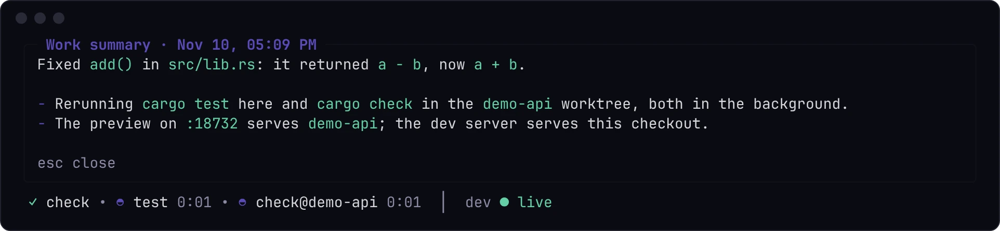
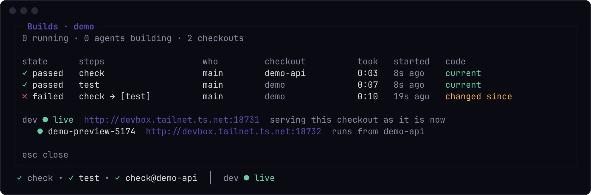

<div align="center">


<h1>omp-builds</h1>

<p>Background builds and a live build status line for OMP.</p>

<p>
  <a href="https://github.com/can1357/oh-my-pi"></a>
  <a href="https://bun.sh"></a>
  <a href="LICENSE"></a>
</p>

<p>
  <a href="#how-it-works">How it works</a> ·
  <a href="#install">Install</a> ·
  <a href="#quick-start">Quick start</a> ·
  <a href="#status-line">Status line</a>
  <br>
  <a href="#commands">Commands</a> ·
  <a href="#configuration">Configuration</a> ·
  <a href="#development">Development</a> ·
  <a href="https://github.com/Shadorain/omp-builds/issues">Report a bug</a>
</p>

</div>

An [OMP](https://github.com/can1357/oh-my-pi) extension that keeps your agent's builds off the critical path. In the repositories you turn it on for, every build the agent runs (`cargo test`, `pnpm check`, `pnpm test:e2e`, `bunx playwright test`, whatever you configure) goes to the background, the turn ends, and one line under the editor shows each step's latest result in every checkout, plus what your dev server is serving. When a turn changed code, the agent's final reply stays open above the editor as a work summary.



## How it works

- **Builds go to the background.** In the interactive main session, a bash call that runs a configured build becomes a background job with no timeout. The agent is told not to wait or poll, and to send one fixer subagent if the build fails. You keep prompting while builds and fixes run; results arrive on their own.
- **One status line per project.** Each step (`check`, `test`, `web test:e2e`, …) shows its latest outcome, newest run first; a chain keeps its own order. Builds in other worktrees carry the worktree name (`check@demo-api`), builds started by other OMP sessions in the same repository show as `other pane`, and a build run by a systemd unit carries the unit name. On a narrow terminal the dev server always stays visible; the oldest steps that don't fit fold into `+N`.
- **Any toolchain.** Track several build commands at once: cargo for the backend, package scripts and Playwright for the frontend. A label keeps two tools' `test` apart.
- **Dev server awareness.** If the project has a shared dev server running as a systemd user unit, the line says whether it serves this checkout, with its tailnet link in `/builds status`. Other user units named after the project that listen on a port (PR previews, Storybook) are listed too.
- **Work summaries.** After a turn that edited files (directly or through a subagent) and left background builds or fixers running, the agent's final reply opens as rendered Markdown above the editor, so their results do not scroll it away. It stays while you type and is replaced by the next one; Esc closes it. When nothing is left running, the reply stays visible in the chat and no window opens; `/builds summary` still lists it.
- **Survives restarts.** Each session's results and summaries are saved to `~/.omp/agent/omp-builds/sessions/<session id>.json`, so `omp -c` or `/resume` brings the status line and `/builds summary` back. A build cut off by the restart shows as stopped; results built from code that changed since are marked stale. Files untouched for 30 days are pruned.
- **How long it usually takes.** Every step that passes records its time per project in `~/.omp/agent/omp-builds/history/<project>.json`, shared by all sessions. A running step then shows its time so far against the median of its last five passes (`◐ test 1:10/~3:00`), and `/builds status` shows the same for the whole chain. A step in a chain is timed by its own process; failed and stopped runs don't count.
- **Off everywhere else.** Outside configured repositories the extension does nothing: no rewrite, no line, no window.

`/builds status` lists every tracked build, which checkout it built, and whether the code changed since:



## Requirements

- OMP 18.18.6 or later.
- Linux: running builds and servers are read from `/proc`, `ss` and `systemctl --user`.
- Git.
- Optional: [Tailscale](https://tailscale.com/) for dev-server links (`https://` when `tailscale serve` fronts the port).

## Install

From the OMP marketplace:

```text
/marketplace add Shadorain/omp-builds
/marketplace install builds@omp-builds
```

Or clone it into the extensions directory:

```bash
git clone https://github.com/Shadorain/omp-builds.git ~/.omp/agent/extensions/omp-builds
```

Restart OMP after installing or updating. `/reload-plugins` does not reload extension code.

## Quick start

1. Open OMP in a repository with an `origin` remote.
2. Run `/builds config add`. Name the project, then pick its dev server from the user units listening on a port, or none. The repository is now auto-loaded: every checkout and worktree whose `origin` matches.
3. Ask the agent to run the tests. `cargo` is tracked out of the box.
4. Track the frontend too: `/builds config build add pnpm`. It suggests the `package.json` scripts that build, check or test, asks for a label (`web`), and whether it applies to this project only. `bunx playwright`, `just`, `make` and any other prefix whose next word is the step work the same way.


## Status line

| Icon | Meaning |
| --- | --- |
| ◐ | Running, with elapsed time |
| ⚒ | A subagent is fixing it, with time and the fixer's name |
| ✓ | Passed |
| ✗ | Failed |
| ■ | Cancelled |

A gray step name means the code changed after that result was built. Each checkout keeps its own steps and is judged against its own code.

### Dev server states

`dev ●` is green while the unit runs. The word compares what it serves with this checkout:

| State | Meaning |
| --- | --- |
| `live` | Serving this checkout as it is now |
| `edits not live` | Serving your last commit; uncommitted edits are not on it |
| `not deployed` | Serving other code; this branch is not on it |
| `rebuilding 3:12` | `redeployUnit` is running; the old build serves until it finishes |
| `behind` | Serving an older build of this checkout (by `builtStamp`) and no redeploy is running |
| `up` | Running; set `deployedShaFile` or `servedCheckoutFile` to compare it with this checkout |
| `unknown` | Cannot tell what it serves |
| `down` | The unit is not running |

Two ways to tell what a server runs: `deployedShaFile` for a server that deploys one commit (this checkout is on it when its `HEAD` is that commit or an ancestor), or `servedCheckoutFile` for a server that runs from a checkout. With `builtStamp`, a served checkout counts as live only once a build of its stamped paths finishes.

A server unit named `<project>*` that runs from this checkout adds `• :3001 ●` after the dev chip.

## Commands

| Command | Use it to |
| --- | --- |
| `/builds` or `/builds status` | List every tracked build and the project's servers |
| `/builds summary` | Pick one of this session's work summaries and show it |
| `/builds summary last` | Show the latest work summary |
| `/builds clear` | Clear finished results from the status line |
| `/builds config` | Show the configuration |
| `/builds config add` | Auto-load the current repository |
| `/builds config remove [name]` | Stop auto-loading a project |
| `/builds config build add [command]` | Track another build command, in every project or this one |
| `/builds config build remove` | Stop tracking a build command |
| `/builds config estimates [on\|off]` | Toggle how long running steps usually take (on by default) |
| `/builds config edit` | Edit the JSON in OMP's editor, validated on save |

## Configuration

Settings live in `~/.omp/agent/omp-builds.json` (under `PI_CODING_AGENT_DIR` when set) and reload when the file changes. Missing keys take their defaults.

A **build** is one tool:

| Key | Meaning |
| --- | --- |
| `command` | Prefix the agent types, or a list of them (`["pnpm", "pnpm run"]`); the next word is the step |
| `process` | Process argv prefix(es) that run a step, when they differ: a wrapper that execs another binary, or Playwright under `bunx` (`"playwright"`) |
| `steps` | Only these steps count, so `pnpm install` stays in the foreground; every word counts when unset |
| `label` | Shown before each step: `web test` |

`builds` applies in every project; `projects[].builds` adds builds for one project. With no `builds` key, `cargo` is tracked with the steps `build`, `check`, `test`, `clippy`, `nextest`, `bench` and `doc`.

`estimates` (default `true`) times passing steps and shows how long a running one usually takes; `false` stops both.

| Project key | Meaning |
| --- | --- |
| `name` | Shown in the UI; also the prefix of user units searched for extra servers |
| `origin` | Case-insensitive regex tested against the `origin` URL |
| `builds` | Builds tracked in this project on top of the global ones |
| `devServer.unit` | systemd user unit of the shared dev server |
| `devServer.deployedShaFile` | File holding the commit the server runs |
| `devServer.servedCheckoutFile` | File holding the path of the checkout the server runs |
| `devServer.builtStamp` | `{ file, paths }`: stamp of the last build, `git rev-parse HEAD:<paths> \| sha1sum \| cut -c1-12` |
| `devServer.redeployUnit` | Unit that rebuilds and restarts the server |

Paths may start with `~/`. A Rust backend with a pnpm frontend and Playwright:

```json
{
	"builds": [{ "command": "cargo", "steps": ["build", "check", "test", "clippy"] }],
	"projects": [
		{
			"name": "shop",
			"origin": "[/:]acme/shop(\\.git)?$",
			"devServer": { "unit": "shop-dev", "deployedShaFile": "~/.local/share/shop-dev/deployed" },
			"builds": [
				{
					"label": "web",
					"command": ["pnpm", "pnpm run"],
					"steps": ["build", "check", "test", "test:e2e"]
				},
				{
					"label": "e2e",
					"command": ["pnpm exec playwright", "npx playwright"],
					"process": "playwright",
					"steps": ["test"]
				}
			]
		}
	]
}
```

Your deploy script writes the dev-server files: the commit it deployed, or the checkout it serves and the stamp of what it built.

## Development

```bash
git clone https://github.com/Shadorain/omp-builds.git
cd omp-builds
bun install
bun test
bun run typecheck
bun run format     # Biome, formatter only: tabs, single quotes, 120 columns
bun run screens    # recapture docs/screens/ from the real TUI (needs omp, python3, systemd user units and Chromium)
```

`bun run screens` drives a real `omp` against a scripted local model, stub `cargo` and `pnpm` commands and two transient user units in a throwaway repository. Contributor rules are in [AGENTS.md](AGENTS.md).

## License

[MIT](LICENSE)
