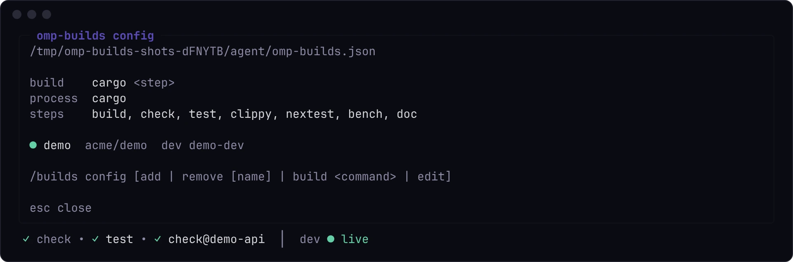

# omp-builds

An [OMP](https://github.com/can1357/oh-my-pi) extension that keeps your agent's builds off the critical path. In the repositories you turn it on for, every `cargo test` (or whatever build command you configure) the agent runs goes to the background, the turn ends, and one line under the editor shows each step's latest result in every checkout, plus what your dev server is serving. When a turn changed code, the agent's final reply stays open above the editor as a work summary.


## How it works

- **Builds go to the background.** In the interactive main session, a bash call that runs the build command becomes a background job with no timeout. The agent is told not to wait or poll, and to send one fixer subagent if the build fails. You keep prompting while builds and fixes run; results arrive on their own.
- **One status line per project.** Each step (`check`, `test`, `clippy`, …) shows its latest outcome. Builds in other worktrees carry the worktree name (`check@demo-api`), builds started by other OMP sessions in the same repository show as `other pane`, and a build run by a systemd unit carries the unit name.
- **Dev server awareness.** If the project has a shared dev server running as a systemd user unit, the line says whether it serves this checkout, with its tailnet link in `/builds status`. Other user units named after the project that listen on a port (PR previews, Storybook) are listed too.
- **Work summaries.** After a turn that edited files (directly or through a subagent), the agent's final reply opens as rendered Markdown above the editor. It stays while you type and is replaced by the next one; Esc closes it.
- **Off everywhere else.** Outside configured repositories the extension does nothing: no rewrite, no line, no window.

`/builds status` lists every tracked build, which checkout it built, and whether the code changed since:


## Requirements

- OMP 18.18.6 or later.
- Linux: running builds and servers are read from `/proc`, `ss` and `systemctl --user`.
- Git.
- Optional: [Tailscale](https://tailscale.com/) for dev-server links (`https://` when `tailscale serve` fronts the port).

## Install

From the OMP marketplace:

```text
/marketplace add Shadorain/omp-builds
/marketplace install builds@omp-builds
```

Or clone it into the extensions directory:

```bash
git clone https://github.com/Shadorain/omp-builds.git ~/.omp/agent/extensions/omp-builds
```

Restart OMP after installing or updating. `/reload-plugins` does not reload extension code.

## Quick start

1. Open OMP in a repository with an `origin` remote.
2. Run `/builds config add`. Name the project, then pick its dev server from the user units listening on a port, or none. The repository is now auto-loaded: every checkout and worktree whose `origin` matches.
3. Ask the agent to run the tests. The status line appears under the editor.
4. Using something other than `cargo`? `/builds config build just`, `/builds config build make`, or any prefix whose next word is the step.



## Status line

| Icon | Meaning |
| --- | --- |
| ◐ | Running, with elapsed time |
| ⚒ | A subagent is fixing it, with time and the fixer's name |
| ✓ | Passed |
| ✗ | Failed |
| ■ | Cancelled |

A gray step name means the code changed after that result was built. Each checkout keeps its own steps and is judged against its own code.

## Dev server states

`dev ●` is green while the unit runs. The word compares what it serves with this checkout:

| State | Meaning |
| --- | --- |
| `live` | Serving this checkout as it is now |
| `edits not live` | Serving your last commit; uncommitted edits are not on it |
| `not deployed` | Serving other code; this branch is not on it |
| `rebuilding 3:12` | `redeployUnit` is running; the old build serves until it finishes |
| `behind` | Serving an older build of this checkout (by `builtStamp`) and no redeploy is running |
| `up` | Running; set `deployedShaFile` or `servedCheckoutFile` to compare it with this checkout |
| `unknown` | Cannot tell what it serves |
| `down` | The unit is not running |

Two ways to tell what a server runs: `deployedShaFile` for a server that deploys one commit (this checkout is on it when its `HEAD` is that commit or an ancestor), or `servedCheckoutFile` for a server that runs from a checkout. With `builtStamp`, a served checkout counts as live only once a build of its stamped paths finishes.

A server unit named `<project>*` that runs from this checkout adds `• :3001 ●` after the dev chip.

## Commands

| Command | Use it to |
| --- | --- |
| `/builds status` | List every tracked build and the project's servers |
| `/builds summary` | Pick one of this session's work summaries and show it |
| `/builds summary last` | Show the latest work summary |
| `/builds clear` | Clear finished results from the status line |
| `/builds config` | Show the configuration |
| `/builds config add` | Auto-load the current repository |
| `/builds config remove [name]` | Stop auto-loading a project |
| `/builds config build <command>` | Set the build command; resets `build.process` and `build.steps` to that command's defaults |
| `/builds config edit` | Edit the JSON in OMP's editor, validated on save |

## Configuration

Settings live in `~/.omp/agent/omp-builds.json` (under `PI_CODING_AGENT_DIR` when set) and reload when the file changes. Missing keys take their defaults.

| Key | Default | Meaning |
| --- | --- | --- |
| `build.command` | `cargo` | Command prefix the agent types; the next word is the step |
| `build.process` | `build.command` | Process argv prefix that runs a step, when it differs (a wrapper that execs another binary) |
| `build.steps` | `build`, `check`, `test`, `clippy`, `nextest`, `bench`, `doc` with `cargo`, else unset | Only these steps count; every word does when unset |
| `projects[].name` | | Shown in the UI; also the prefix of user units searched for extra servers |
| `projects[].origin` | | Case-insensitive regex tested against the `origin` URL |
| `projects[].devServer.unit` | | systemd user unit of the shared dev server |
| `projects[].devServer.deployedShaFile` | | File holding the commit the server runs |
| `projects[].devServer.servedCheckoutFile` | | File holding the path of the checkout the server runs |
| `projects[].devServer.builtStamp` | | `{ file, paths }`: stamp of the last build, `git rev-parse HEAD:<paths> \| sha1sum \| cut -c1-12` |
| `projects[].devServer.redeployUnit` | | Unit that rebuilds and restarts the server |

Paths may start with `~/`.

```json
{
	"build": { "command": "cargo" },
	"projects": [
		{
			"name": "api",
			"origin": "[/:]acme/api(\\.git)?$",
			"devServer": { "unit": "api-dev", "deployedShaFile": "~/.local/share/api-dev/deployed" }
		},
		{
			"name": "web",
			"origin": "[/:]acme/web(\\.git)?$",
			"devServer": {
				"unit": "web",
				"servedCheckoutFile": "~/.local/share/web-dev/checkout",
				"builtStamp": { "file": "~/.local/share/web-dev/built", "paths": ["Cargo.lock", "crates"] },
				"redeployUnit": "web-dev"
			}
		}
	]
}
```

Your deploy script writes the files: the commit it deployed, or the checkout it serves and the stamp of what it built.

## Development

```bash
git clone https://github.com/Shadorain/omp-builds.git
cd omp-builds
bun install
bun test
bun run typecheck
bun run format     # Biome, formatter only: tabs, single quotes, 120 columns
bun run screens    # recapture docs/screens/ from the real TUI (needs omp, python3, systemd user units and Chromium)
```

`bun run screens` drives a real `omp` against a scripted local model, a stub `cargo` and two transient user units in a throwaway repository. Contributor rules are in [AGENTS.md](AGENTS.md).

## License

[MIT](LICENSE)
